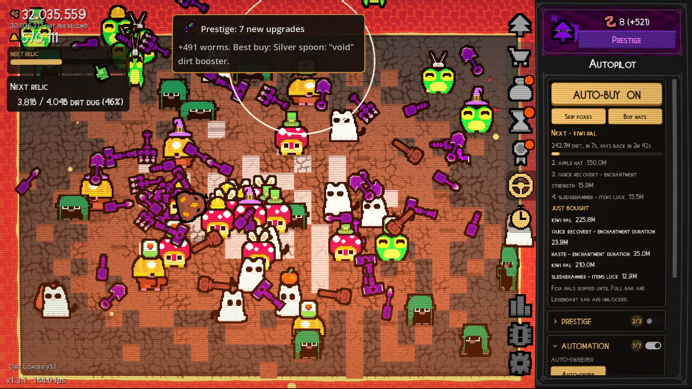
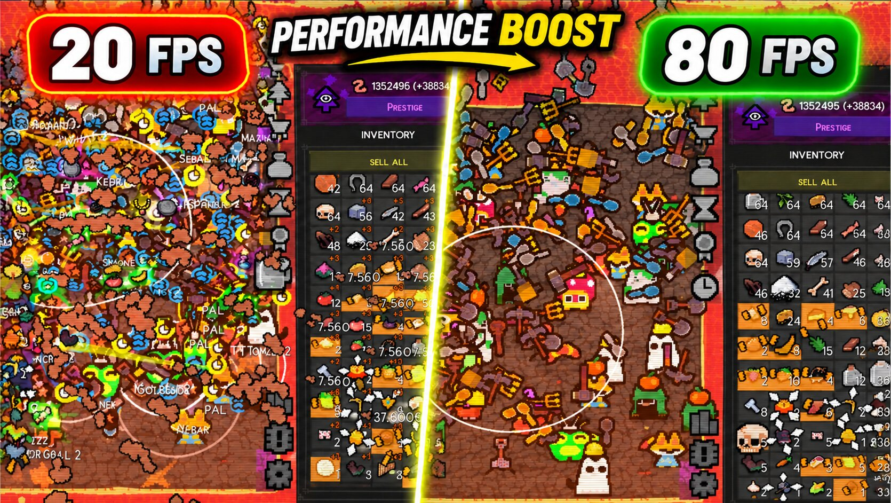
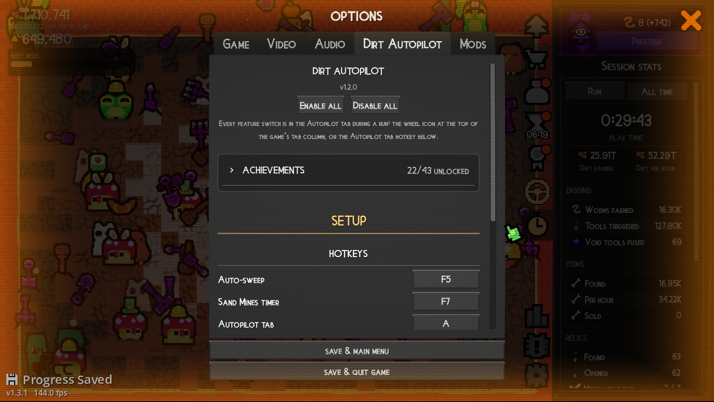
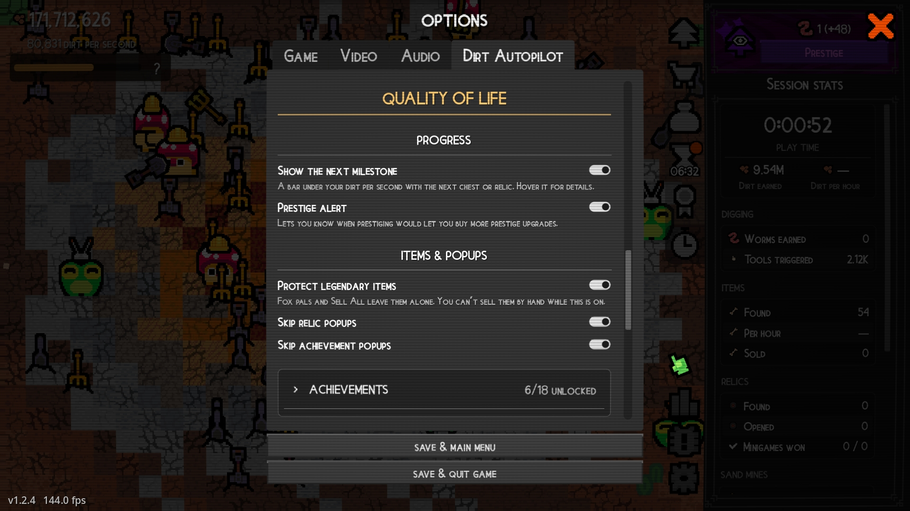
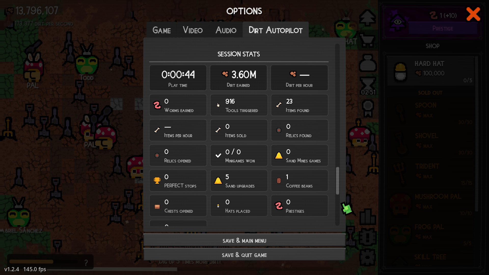
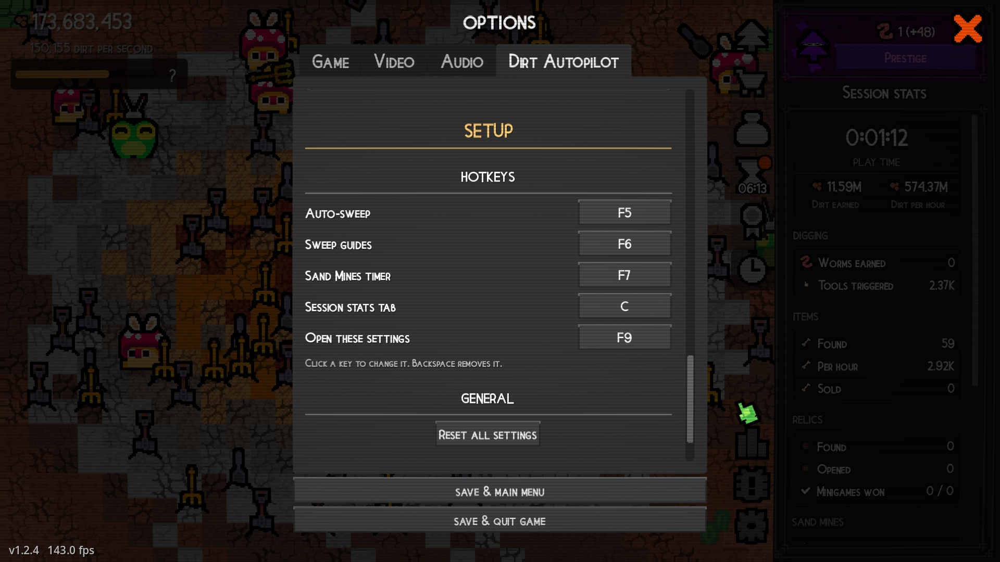

# Dirt Autopilot

An in-game automation helper for **Dirt Clicker**. Website: [eyyminda.github.io/DirtAutopilot](https://eyyminda.github.io/DirtAutopilot/) · Download: [Nexus Mods](https://www.nexusmods.com/dirtclicker/mods/1) or [GitHub releases](https://github.com/eyyMinda/DirtAutopilot/releases/latest). Unofficial and fan-made; not affiliated with the developers of Dirt Clicker.

Most features are **off until you switch them on**, in the **Autopilot** tab of the game's tab column (or **A**). On from the start: spending sand, legendary protection, putting hats on pals, the next-milestone bar and the prestige alert.

## What it can do

The Autopilot tab holds every switch: the shop card on top, then **Prestige**, **Automation**, **Hats on pals** and **Display** cards, each with a switch for all of it. **Options → Dirt Autopilot** keeps Enable all / Disable all, the achievements checklist, hotkeys and reset.

| Section | Feature |
| --- | --- |
| Performance | FPS savers for the late game, with one switch for all of them: hide dig effects (dust puffs, zap lines, item pops), buff icons, stomp circles, pal names, sell amounts and the +N on new items. |
| Auto-sweeper | Moves the hover circle onto tools that are ready, as many per stop as possible. Your real mouse is never moved, and when nothing is ready the circle follows your mouse as usual. |
| Sand Mines | Plays the Sand Mines timer for a PERFECT every round, starting it whenever it's ready. Spends your sand on all upgrades at once. |
| Relics | Solves the relic minigames: words, math cards, dice and the rest. Opens your relics one at a time. |
| Pickups | Grabs the coffee bean and opens chests you have the key for. |
| Shopping | Buys from the shop and the skill tree, whatever pays for itself fastest based on what each tool earns this run, and saves up for something better when it's close. Skips fox pals while you're still growing stacks for Full bag and Legendary bag. Hats optional. |
| Prestige | Spends worms on the advisor's best prestige upgrade, and can prestige by itself once new upgrades are affordable and the run slows down, optionally starting the next run in the world you pick (by default the latest one before the Void). |
| Hats on pals | Puts each new hat on a pal it actually helps, or the pal you pick for each hat. With the game's pal naming on, each pal gets a name from the game's credits, starting with Todd for the achievement. |
| Progress | Two bars under your dirt and sand counters: how close the next relic is, and the next chest with its icon (hidden once every chest has been opened). Hover them for details. A prestige alert tells you when prestiging would let you buy more prestige upgrades, and the prestige advisor names the best one to buy and marks it in the prestige tree. |
| Items & popups | Protects legendary items from fox pals and Sell All. Skips relic and/or achievement popups before they're even drawn. |
| Achievements | A checklist of the game's achievements with your progress, which of the mod's features earns each one, and a **Do it** button for the cookie-clicking and volume ones. |
| Autopilot tab | Its own **Autopilot** tab in the game's tab column (or **A**): a big AUTO-BUY switch, the next purchase with a countdown and payback time, then all the mod's switches in foldable cards, two per row. |
| Session stats | Its own **Session stats** tab after Badges in the game's tab column (or **C**): tiles with play time, dirt and worms earned, dirt and items per hour, tools triggered, relics, minigames, sand, coffee, chests, hats, prestiges and achievements. **Run** shows the current run (resets on prestige) with your tools ranked by dirt earned (name, share %, dirt/s), **All time** keeps counting across launches; minigames, chests, sand upgrades, hats and achievements show your save's progress. Each save slot keeps its own stats. |

Performance, Hats on pals and Achievements are cards you can fold away; their switch and status stay visible while closed.

## Screenshots

| | |
| --- | --- |
|  |  |
| **Performance** options late in the game | **Options → Dirt Autopilot** |
|  |  |
| **Quality of life** | **Session stats tab** and the prestige alert |

## Install

Dirt Autopilot needs Dirt Clicker 1.3.1 or newer and a mod loader. It works with both [DirtLoader](https://www.nexusmods.com/games/dirtclicker/mods) from Nexus Mods and the [Godot Mod Loader](https://github.com/GodotModding/godot-mod-loader).

1. Install your mod loader by following its own instructions.
2. Download `eyyMinda-DirtAutopilot-<version>.zip` from the [latest release](https://github.com/eyyMinda/DirtAutopilot/releases/latest).
3. Put the mod where your loader looks for mods:
   - **Godot Mod Loader:** put the `.zip` as-is in `<game folder>\mods\`.
   - **DirtLoader:** extract the zip into `<game folder>\mods\`, so you get `<game folder>\mods\eyyMinda-DirtAutopilot\`.
4. Start a run and open the **Autopilot** tab (the wheel icon in the game's tab column, or **A**). Hotkeys, achievements and reset are in **Options → Dirt Autopilot** (with DirtLoader also **Options → Mods → Settings**).

## Hotkeys

| Key | Action |
| --- | --- |
| F5 | Auto-sweep on/off |
| F7 | Sand Mines timer on/off |
| A | Open or close the Autopilot tab |
| C | Open or close the Session stats tab |
| F9 | Open or close the Dirt Autopilot settings |

To change a key, click it in the **Hotkeys** section of **Options → Dirt Autopilot**, then press the new one. Esc cancels and Backspace removes it.

## Good to know

- **Protect legendary items** locks them, so you can't sell them by hand either while it's on. Switch it off to sell them.
- **Open relics** only opens relics that start a minigame while **Solve relic minigames** is on, so a minigame never pops up by surprise.
- While auto-sweep holds the circle on some tools, clicking a chest or other clickable thing in the field uses the circle's position, not your mouse. Press F5 to pause it.
- The mod checks GitHub for a new version when the game starts and shows an alert if there is one.
- **Put hats on pals** never puts a hat on a pal it does nothing for. If none of the right pals is free, the hat stays in the hat picker until you place it or buy a suitable pal.
- DirtLoader turns Steam achievements off while mods are loaded, unless you enable them in **Options → Mods**. That's DirtLoader's setting, not this mod's.

Settings are saved to `%APPDATA%\Godot\app_userdata\Dirt Clicker\DirtAutopilot\settings.json`. **Reset all settings** at the bottom of the page restores the defaults.

## Uninstall

Delete the mod's folder or zip from `<game folder>\mods\`. To remove its settings too, delete `%APPDATA%\Godot\app_userdata\Dirt Clicker\DirtAutopilot\`.

## License

Dirt Autopilot is licensed under the [GNU General Public License v3.0](LICENSE).
