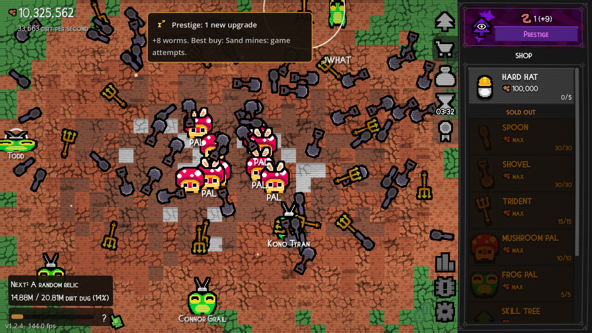
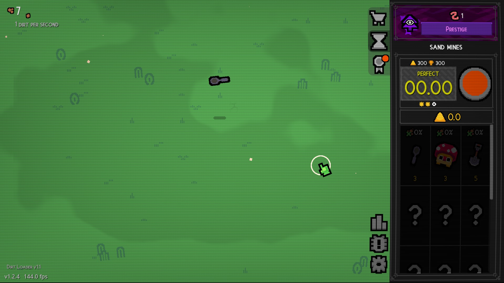
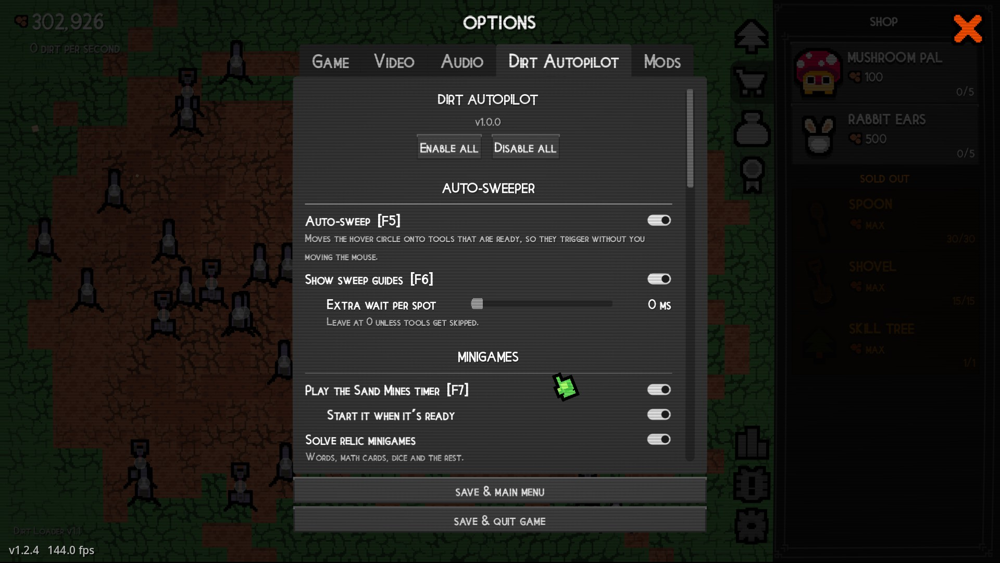
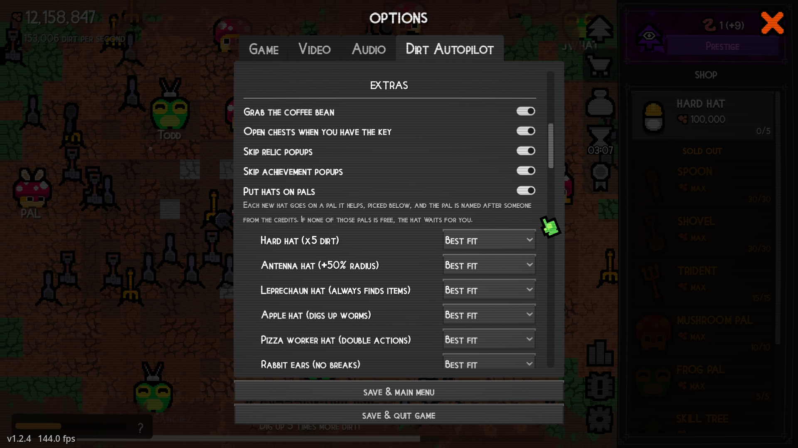
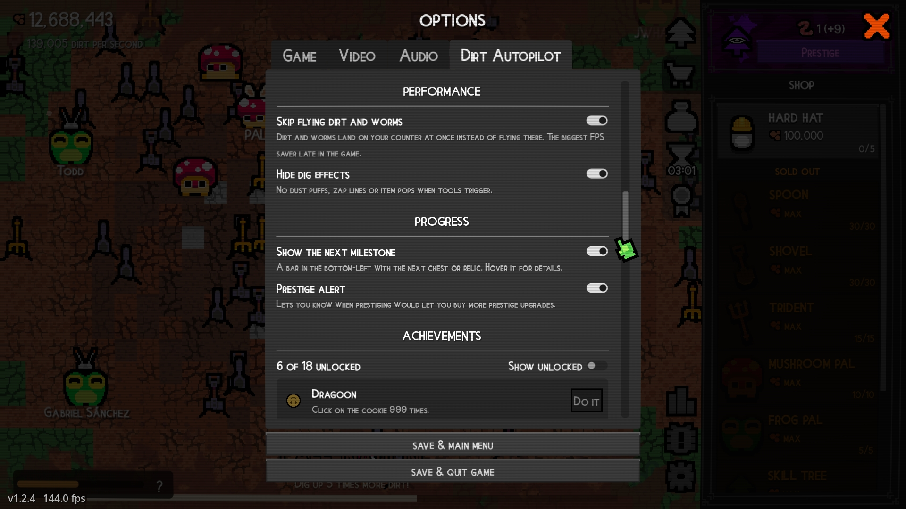
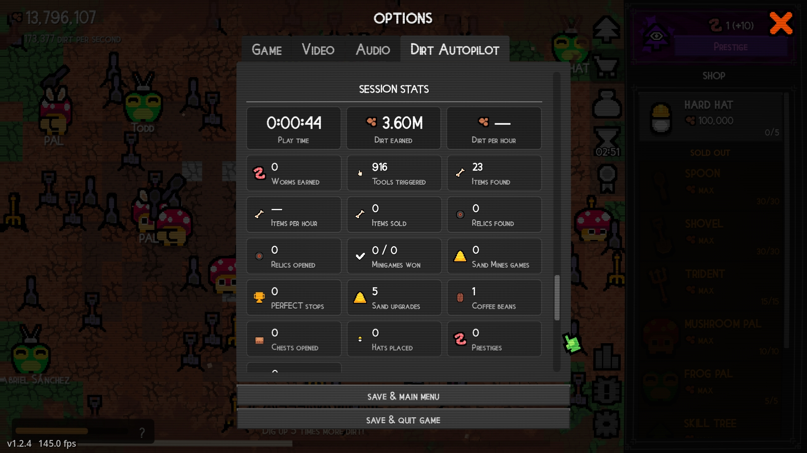
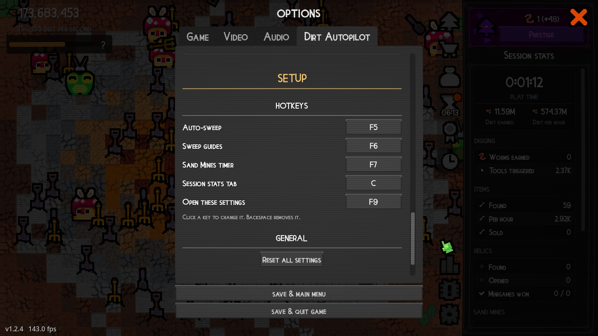

# Dirt Autopilot

An in-game automation helper for **Dirt Clicker**. Website: [eyyminda.github.io/DirtAutopilot](https://eyyminda.github.io/DirtAutopilot/) · Download: [Nexus Mods](https://www.nexusmods.com/dirtclicker/mods/1) or [GitHub releases](https://github.com/eyyMinda/DirtAutopilot/releases/latest). Unofficial and fan-made; not affiliated with the developers of Dirt Clicker.

Most features are **off until you switch them on**, in **Options → Dirt Autopilot**. On from the start: sweep guides, spending sand, legendary protection, putting hats on pals, the next-milestone bar and the prestige alert.

## What it can do

| Section | Feature |
| --- | --- |
| Auto-sweeper | Moves the hover circle onto tools that are ready, as many per stop as possible. Your real mouse is never moved, and when nothing is ready the circle follows your mouse as usual. |
| Sand Mines | Plays the Sand Mines timer for a PERFECT every round, starting it whenever it's ready. Spends your sand on all upgrades at once. |
| Relics & items | Solves the relic minigames: words, math cards, dice and the rest. Opens your relics one at a time. Protects legendary items from fox pals and Sell All. |
| Extras | Grabs the coffee bean, opens chests you have the key for, skips relic and/or achievement popups, and puts each new hat on a pal it actually helps. You can choose the pal for each hat. Each pal gets a name from the game's credits, starting with Todd for the achievement. |
| Performance | Optional FPS savers for the late game: dirt and worms land on the counter at once instead of flying there, and dig effects (dust puffs, zap lines, item pops) can be hidden. |
| Progress | A bar in the bottom-left showing the next milestone: its icon (or **?** when it's a random relic) and how close you are. Hover it for details. A prestige alert tells you when prestiging would let you buy more prestige upgrades, and the prestige advisor names the best one to buy and marks it in the prestige tree. |
| Achievements | A checklist of the game's achievements with your progress, which of the mod's features earns each one, and a **Do it** button for the cookie-clicking and volume ones. |
| Session stats | Tiles with play time, dirt and worms earned, dirt and items per hour, tools triggered, relics, minigames, sand, coffee, chests, hats, prestiges and achievements since you started the game. |

## Screenshots

| | |
| --- | --- |
|  |  |
| **Sand Mines:** stopped at 00.00, PERFECT | **Options → Dirt Autopilot** |
|  |  |
| **Extras:** a pal picker for every hat | **Performance, Progress and Achievements** |
|  | |
| **Session stats** | |

## Install

Dirt Autopilot needs a mod loader. It works with both [DirtLoader](https://www.nexusmods.com/games/dirtclicker/mods) from Nexus Mods and the [Godot Mod Loader](https://github.com/GodotModding/godot-mod-loader).

1. Install your mod loader by following its own instructions.
2. Download `eyyMinda-DirtAutopilot-<version>.zip` from the [latest release](https://github.com/eyyMinda/DirtAutopilot/releases/latest).
3. Put the mod where your loader looks for mods:
   - **Godot Mod Loader:** put the `.zip` as-is in `<game folder>\mods\`.
   - **DirtLoader:** extract the zip into `<game folder>\mods\`, so you get `<game folder>\mods\eyyMinda-DirtAutopilot\`.
4. Start the game and open **Options → Dirt Autopilot**. With DirtLoader, **Options → Mods → Settings** opens the same page.

## Hotkeys

| Key | Action |
| --- | --- |
| F5 | Auto-sweep on/off |
| F6 | Sweep guides on/off: a dot on each ready tool, a ring where the sweeper is |
| F7 | Sand Mines timer on/off |
| Insert | Show what's switched on, plus play time and dirt for this session |
| F9 | Open or close the Dirt Autopilot settings |

To change a key, click it in the **Hotkeys** section, then press the new one. Esc cancels and Backspace removes it.

## Good to know

- **Protect legendary items** locks them, so you can't sell them by hand either while it's on. Switch it off to sell them.
- **Open relics** only opens relics that start a minigame while **Solve relic minigames** is on, so a minigame never pops up by surprise.
- While auto-sweep holds the circle on some tools, clicking a chest or other clickable thing in the field uses the circle's position, not your mouse. Press F5 to pause it.
- The mod checks GitHub for a new version when the game starts and shows an alert if there is one.
- **Put hats on pals** never puts a hat on a pal it does nothing for. If none of the right pals is free, the hat stays in the hat picker until you place it or buy a suitable pal.
- DirtLoader turns Steam achievements off while mods are loaded, unless you enable them in **Options → Mods**. That's DirtLoader's setting, not this mod's.

Settings are saved to `%APPDATA%\Godot\app_userdata\Dirt Clicker\DirtAutopilot\settings.json`. **Reset all settings** at the bottom of the page restores the defaults.

## Uninstall

Delete the mod's folder or zip from `<game folder>\mods\`. To remove its settings too, delete `%APPDATA%\Godot\app_userdata\Dirt Clicker\DirtAutopilot\`.

## License

Dirt Autopilot is licensed under the [GNU General Public License v3.0](LICENSE).
